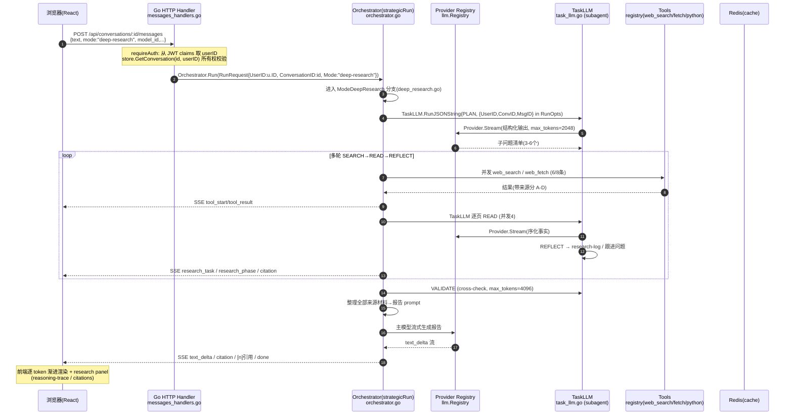
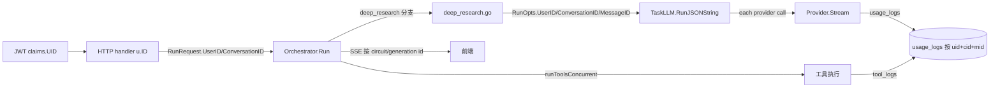

# Aivory 中「Agent / Subagent」流程、前后端接口与多用户隔离分析

> 场景：用户在 Web 端访问 Agent 并触发一次「主 agent 派生子 agent（subagent）」的工作。
> 本文档回答：**前后端接口如何打通？后端 Agent 服务是否单实例？多用户为何不混淆？subagent 是否也调用后端 LLM API？subagent 如何归属到主会话与用户？**
>
> 源码基准：Aivory v2.5.2-beta.12（Go 后端 + React 前端 + Python 沙箱）。

---

## 0. 一句话结论（先给答案）

1. **项目里没有字面的 "subagent" 组件**，但 `deep_research`（深度研究引擎）与 Orchestrator 的工具派发，就是「主 agent → 派生子任务（subagent）」的真实实现。
2. **前后端接口**：前端 `POST /api/conversations/:id/messages`（带 `mode:"deep-research"`），后端以 **SSE 流**回传 `research_*`/`tool_start`/`tool_result`/`text_delta`/`done` 事件；subagent 的进度是**同一根 SSE 流**上的多个事件，不是另开连接。
3. **后端不是单实例，可多实例横向扩展**：某一次生成由**某一个实例**的 `Orchestrator.Run` 同步处理（SSE 长连接绑到该实例）；跨实例协调（停止、撤销、配置失效）走 **Redis pub/sub**，topic 按 `(userID, conversationID, messageID)` 精确命名，绝不误停他人。
4. **多用户不混淆**：JWT claims → `userID`；每个请求是独立 goroutine（上下文局部）；`store` 层**每条查询都按 `userID` 过滤**；并发配额、停止 topic、请求签名全部绑定 `userID`。
5. **subagent 也调用后端 LLM API**：`deep_research` 的每个阶段（PLAN/READ/REFLECT/VALIDATE/WRITE）都是一次对 LLM 的调用，走**同一套 Provider 注册表**；子任务用 **TaskLLM（结构化 JSON 输出）**，最终报告用主模型。
6. **subagent 的归属**：`RunOpts{UserID, ConversationID, MessageID, WorkspaceID}` **贯穿每一次子任务 LLM 调用**（用于计费 `usage_logs`）；`conversationID` 同时是子任务状态持久化与沙箱工作区归档的锚点。

---

## 1. 概念澄清：Aivory 的「subagent」是什么

搜索 `server/internal/ src/` **无 "subagent" 关键字**。具备「主 agent 派生子 agent」语义的机制有两个：

| 机制 | 对应「subagent」语义 | 源码 |
|---|---|---|
| **Deep Research 引擎** | 主问题被分解为 3–6 个子问题，每个子问题独立「搜索→阅读→反思」，可并行——**这是最接近 subagent 的真实实现** | `server/internal/llm/deep_research.go` |
| **工具派发（tool loop）** | 主 Orchestrator 在一个回合内并发调用多个工具（web_search/web_fetch/python_execute/image_generate…） | `server/internal/llm/tool_exec.go` |

`deep_research.go:1-36` 明确定义了流水线：

```
PLAN     — TaskLLM 分类研究类型，把主题分解为 3-6 个子问题 + 构造检索 query
SEARCH   — 每轮并发 aivory_web_search + web_fetch（drQueriesPerRound=6，drFetchPerRound=8）
READ     — TaskLLM 逐页阅读、提炼成 dated facts + leads（drReadConcurrency=4 并行）
REFLECT  — TaskLLM 审阅所有笔记，产出 research-log、弱主张、跟进问题，可新增子问题
VALIDATE — TaskLLM 交叉校验 → confirmed/disputed/unverified
WRITE    — 主模型流式输出带 [n] 引用的报告
```

**关键**：这些「子任务」**不是独立常驻的 agent 进程**，而是**同一请求进程内、由结构化输出驱动的多次 LLM 调用 + 并发工具执行**，全部生命周期收敛在这一次 HTTP 请求的 SSE 流内。

---

## 2. 端到端时序（subagent 完整工作流）



**前端视角**：`src/store/conversations.ts` 的 `sendMessage` 调 `streamSSE('/conversations/:id/messages', {text, mode, ...})`，`for await (frame of ...)` 按 `ev.type` 分派（`message_start`/`research_plan`/`research_task`/`tool_start`/`tool_result`/`text_delta`/`done`/`error`）。**subagent 的所有子任务进度都在这根 SSE 流里**，前端据此渲染研究面板（`research-panel.tsx`）与推理轨迹。

---

## 3. 前后端接口细节

### 3.1 发起（前端 → 后端）
- 路径：`POST /api/conversations/:id/messages`（见 `client.ts` `streamSSE` + `conversations.ts:2128`）
- 关键请求体字段（`conversations.ts:2130-2163`）：`text`、`mode:"deep-research"`、`model_id`、`kb_ids`、`parent_id`、`branch`、`tool_mode`、`selected_tool_ids`、`web_search`、`fast`、`attachments`、`params`、`image_style_id`、`locale`、`generation_id` 等。
- 鉴权头（见《frontend-01》）：`Authorization: Bearer <jwt>` + v2 请求签名（`x-req-*` 系列）+ httpOnly cookie。

### 3.2 回传（后端 → 前端，SSE 流）
后端处理端点在 `messages_handlers.go:1581` 构造 `Orchestrator.Run(RunRequest{UserID: u.ID, ConversationID: id, Mode: req.Mode, ...})`。SSE 事件必须对齐前端 `ApiSseEvent`（见《backend-02》《frontend-02》），至少包含：

| type | 含义（前端处理） |
|---|---|
| `message_start` | 助手占位已建，前端重键为后端 `message_id` |
| `research_plan / research_task / research_source / research_note / research_phase` | 深度研究面板进度 |
| `tool_start / tool_input / tool_result` | subagent 派发的工具生命周期（含 citation） |
| `text_delta / thinking_delta` | 主模型渐进输出 |
| `done` / `error` | 流结束 |

### 3.3 停止（前端 → 后端，跨进程）
前端 `abortStream` → `POST /api/conversations/:id/stop`（body 带 `message_id`）→ 后端 `revokeMessageGenerationStreams` → **`d.Cache.Publish(genstream.RevocationTopic(messageID), "1")`**（`messages_handlers.go:320-332`）广播到所有实例，正在生成的实例收到后停止流并持久化部分输出。

---

## 4. 后端 Agent 服务是否「单个实例」？

**不是。是设计上支持多实例（无状态、可水平扩展）的。**

```mermaid
graph TB
    subgraph LB[负载均衡 / 反向代理]
        U1[用户请求]
    end
    subgraph Inst[后端实例(可多个)]
        I1[实例A<br/>Orchestrator.Run + SSE]
        I2[实例B<br/>Orchestrator.Run + SSE]
    end
    R[(Redis pub/sub)]
    PG[(PostgreSQL)]
    Q[(Qdrant)]
    U1-->LB
    LB-->I1
    LB-->I2
    I1---R
    I2---R
    I1---PG
    I2---PG
    I1---Q
    I2---Q
```

- **一次生成绑定一个实例**：`Orchestrator.Run` 是**同步阻塞**调用，SSE 长连接由发起该请求的那个实例持续写入（HTTP `WriteTimeout=90min`）。因此 **整个 subagent 生命周期都在同一实例同一 goroutine 树内**，无跨实例状态。
- **跨实例协调**（任何实例都可能需要影响其它实例正在跑的生成）全部走 **Redis pub/sub**：
  - 停止流：`Publish(RevocationTopic(messageID))`，各实例订阅自己当前运行的消息并本地终止。
  - 实时封禁/会话失效：`cache.Publish` + 每个实例订阅。
  - 配置变更失效：`cfg:invalidate` 广播（`main.go:87-92`）。
  - 工作区/知识库撤销：`workspace:...:user:...:generation-revoked` 等（`messages_handlers.go:199-224`）。
- **可选降级**：无 Redis 时（personal/dev）`cache.NewMemory()`，等于单实例进程内协调——`main.go:71-82`。
- **异步任务**（RAG 摄取等）生产用 Redis + asynq（可多 worker 实例），个人版降级进程内队列（`queue.NewInProcess`）。

> **结论**：默认部署可能是单容器，但**架构层面是无状态多实例**；subagent 不需要跨实例心智，因为它和主请求在同一个实例内完成。

### 4.1 摘要：停止为何能跨实例「精准送达」且「不错停」（精要）

「停止生成」是跨实例最难做对的一点，其做法（代码级深析见《停止生成跨实例精准送达机制分析.md》）可概括为 **三层通道 + 原子墓碑**：

1. **实时主通道（Redis Pub/Sub）**：停止端点发布到三级粒度的 topic——`generationStopTopic(uid,cid,gid)`、`messageStopTopic(uid,cid,mid)`、`conversationStopTopic(uid,cid)`（`messages_handlers.go:183-188`）。正在住生成的那个实例（`Orchestrator.Run` 所在）通过 `generationStopWatcher` 订阅后 `cancel()` → 终止 provider 流，丢弃迟到 delta。
2. **持久 stop 意图标记（防竞态）**：`publishScopedStop` 先 `Set(scopedStopIntentKey)` 再 `Publish`；订阅方**先订阅、再查标记**（`messages_handlers.go:904-929`）。官方注释点明这是为弥合「Stop 先到、generation 还没订阅」的竞态——pub/sub 被刻意视为 best-effort。
3. **原子墓碑（最终一致性）**：每个生成事件经 **Redis Lua 脚本**「先 `EXISTS` 查 `gen:{mid}:revoked` 墓碑、再 `XADD` 到流」。被吊销后 `Append` 返回 `revoked=true` → 生成实例即便错过广播也会停止；跟随者（重连/另一设备）回读流读到墓碑即发 `done(stopped)`。
4. **多用户不错停**：路线所有权校验先行——`stopHandler` 先 `store.GetConversation(id, u.ID)`（`conversations_handlers.go:1618`），且每个 topic/key 都绑定 `userID`；workspace 成员共享会话但**不能互相取消生成**（`conversations_handlers.go:1662-1665`）。

> 三层任一都可能漏（广播无订阅者、墓碑 TTL 过期），故还有 **DB 状态轮询兜底**（跟随者定时查 `status != streaming`），保证「至少一通道必然命中」。个人版无 Redis 时用 `cache.NewMemory()` 进程内实现，语义与 Redis 对等。

---

## 5. 多用户为何不会混淆

隔离由 **四层** 共同保证（层层绑定 `userID`）：

```mermaid
graph LR
    A[JWT claims.UID] --> B[requireAuth 校验<br/>token_ver/会话/封禁/CSRF/请求签名]
    B --> C[store 层 userID 过滤<br/>GetConversation(id,userID)]
    B --> D[上下文局部<br/>每请求独立 goroutine]
    B --> E[命名空间隔离<br/>topic/key 含 userID]
```

### 5.1 身份来源（middleware.go:73-150）
`requireAuth`：
- `readAccessToken` → `d.Auth.ParseAccess(token)` 得 `claims.UID / SessionID / TV`；
- 强校验：CSRF（`csrfOK`）、**请求签名**（`verifyRequestSignature(token, requestKey, claims.UID, claims.SessionID, r)`，绑定用户+会话+一次性 nonce）、`GetUserAuthStateForSession`（`Status/token_ver/会话 active`）；
- 通过后把 `user`（含 `user.ID/UID`）注入请求上下文（`setAuditActor`）。

### 5.2 store 层按 userID 过滤（防越权读）
- `store.GetConversation(ctx, db, id, userID)`（`store/conversations.go:299`）：SQL 带 `WHERE c.id=? AND conversationResourceAccessPredicate("c")`，用 `workspaceResourceAccessArgs(userID)` 约束——**用户只能拿到「自己所有或所属工作区有权限」的会话**。消息、文件、知识库同理按 userID 校验。
- 因此即使用户 A 猜中/拿到用户 B 的 `conversationID`，`GetConversation(id, userA.ID)` 也返回空（`sql.ErrNoRows`）。

### 5.3 每请求 goroutine 上下文
- Go 每连接一 goroutine，`RunRequest.UserID` 等走调用栈显式传递，无全局会话态 → **天然无用户间共享可变状态**。

### 5.4 命名空间隔离的 key/topic（并发/停止/配额）
- 并发生成配额：`gen:active:{userID}`（middleware.go:370 `reserveConcurrentGen`）——每用户并发上限。
- 当日 token 配额：`store.BillingTokensSince(..., userID, ...)`。
- 停止 topic：`user:{uid}:conv:{cid}:generation:{gid}:stop`（messages_handlers.go:183）、`conversation:{cid}:generation-revoked`。
- 工作区/KB 撤销：`workspace:{wid}:user:{uid}:generation-revoked`、`knowledge-base:{kbid}:user:{uid}:...`。
- 请求签名 nonce：`reqnonce:{uid}:{sessionID}:{nonce}`。
- RAG 会话/空间：`ragSvc` 内按 `userID`/`conversationID` 隔离检索上下文与引用。

---

## 6. subagent 是否调用后端 LLM API？—— 是

`deep_research` 的每个阶段都是一次真实的 LLM 调用，**全部走同一套 `llm.Registry`（Provider 注册表，可配多家 OpenAI 兼容/Anthropic/DeepSeek…）**：

| 阶段 | 用什么模型 | 调用形态 |
|---|---|---|
| PLAN | TaskLLM（结构化 JSON） | `Provider.Stream`，`drPlanMaxOutputTokens=2048` |
| READ | TaskLLM | 每页一次，`drReadConcurrency=4` 并行，`drReadMaxOutputTokens=1536` |
| REFLECT | TaskLLM | `drReflectMaxOutputTokens=2048` |
| VALIDATE | TaskLLM | `drValidateMaxOutputTokens=4096` |
| WRITE | **主模型** | 流式输出报告（受独立时间预算约束） |

- **TaskLLM（`task_llm.go`）**：`RunJSONString(ctx, kind, prompt, out any, RunOpts)` 强制结构化 JSON 输出，是「subagent 决策单元」的载体（`PLAN`/`READ`/`REFLECT`/`VALIDATE` 各是一个 `TaskKind`）。
- 每个子任务完成 token 计费（`usage_logs`）与并发被 `RunOpts` 中的身份字段锚定（下节）。
- 工具调用（搜索/抓取/代码）由 `runToolsConcurrent`（`tool_exec.go`）用信号量并发执行。

---

## 7. subagent 如何知道属于哪个主会话与用户？

**答案：`RunOpts` 把身份显式贯穿到每一次子任务/工具/计费调用。**

```go
// task_llm.go:237
type RunOpts struct {
    UserID         string // ← 归属用户
    ConversationID string // ← 归属主会话
    MessageID      string // ← 归属那条助手消息（生成流）
    WorkspaceID    string // ← 归属工作区（spend 归属）
    ...
}
```

贯穿路径（真实调用链）：



要点：
1. **从哪来**：HTTP `requireAuth` 把 `userID`（`u.ID`）注入，`messages_handlers.go:1581` 把 `RunRequest{UserID, ConversationID: id}` 传给 `Orchestrator.Run`。
2. **如何贯穿到 subagent**：deep_research 内部把 `UserID/ConversationID/MessageID/WorkspaceID` 填进每个 `RunOpts` → `TaskLLM` → provider 调用，从而 `usage_logs` 能精确记账「**这个用户、这个会话、这条消息** 的这张 subagent 服务账单」。
3. **会话作为持久化锚点**：`conversationID` 还用于——
   - 深度研究面板状态持久化（`Kind:"research"` block，重载重灌）；
   - 沙箱工作区归档的**稳定键**（`archiveKey = conversationID`，实现跨会话 recycle 的 workspace 存活）；
   - `research_*` 事件与 `message_id` 一起写回数据库（`store.MarkMessage...`）。
4. **多实例下也不丢**：即使请求被负载均衡到不同实例（初次与重连），身份字段在每个请求里都自带，`stop`/`revocation` 也按 `uid+cid+mid` 的 topic 精准送达目标实例。

---

## 8. 对「Python 后端复刻」的实现要点（衔接《99-复刻路线图》）

1. **身份贯穿**：FastAPI 中做 `Depends(get_current_user)`（返回 Pydantic `CurrentUser{id, session_id}`），先生成并发到各 service/编排器/子任务函数，确保每次 LLM 调用与计费都带 `user_id/conversation_id/message_id`。
2. **单请求多实例语义**：Python 后端目标同样「无状态、可水平扩展」；用 `asyncio` 任务承载一次 `agent.run(...)`，SSE 用 FastAPI `StreamingResponse`；跨实例停止用 `redis-py` pub/sub（topic 格式保持 `user:{uid}:conv:{cid}:generation:{gid}:stop`）。
3. **subagent 用结构化工具**：子任务（PLAN/READ 等）用 Pydantic（对齐 `typesafe`）+ provider 的 JSON mode / tool calling；主模型输出报告走正常流式。
4. **所有权校验不能省**：所有 `get_conversation(id, user_id)` / `get_message(...)` 都要带 user_id 过滤（对齐 `conversationResourceAccessPredicate`），**这是多租户/多用户隔离的底线**。
5. **并发/配额**：`gen:active:{user_id}` 每个用户的并发生成、每日 token 配额，用 Redis key 或进程内锁实现。
6. **归属锚点**：`conversation_id` 作为研究状态块、沙箱归档 key 的稳定身份，Python 复刻保持一致命名，避免前端/沙箱改动。

---

## 9. 参考

- 本项目「subagent」真实形态：`server/internal/llm/deep_research.go`、`task_llm.go`、`tool_exec.go`
- 身份与隔离：`server/internal/api/middleware.go:73-150`、`messages_handlers.go:1581/320`、`store/conversations.go:299`
- 停止跨实例：`messages_handlers.go:183-232, 320-349`（`genstream.RevocationTopic`）
- 前端消费：`src/store/conversations.ts:2128-2400`、`client.ts streamSSE`
- 配套文档：《后端-02-LLM编排与流式》《前端-01》《前端-02》《99-复刻路线图-Python后端》《部署-容器与CI与系统更新》（多实例与 Redis/pub-sub、uwsgi 部署）、《停止生成跨实例精准送达机制分析》（停止如何跨实例精准送达的代码级深析）
