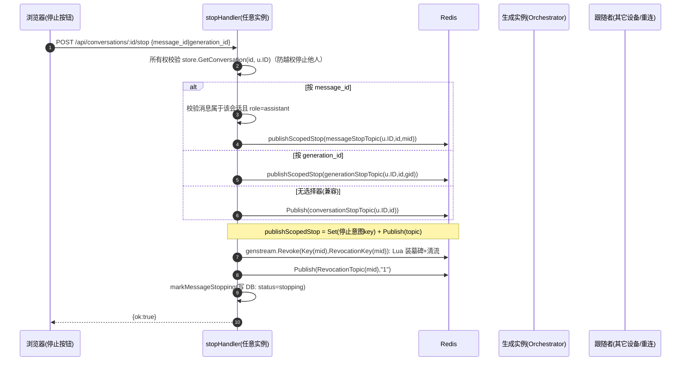
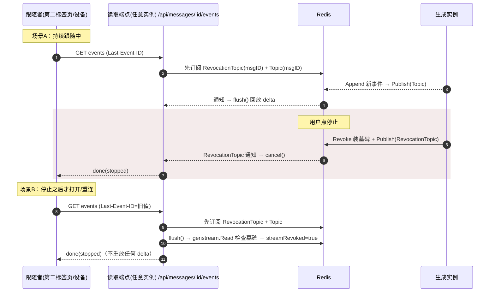
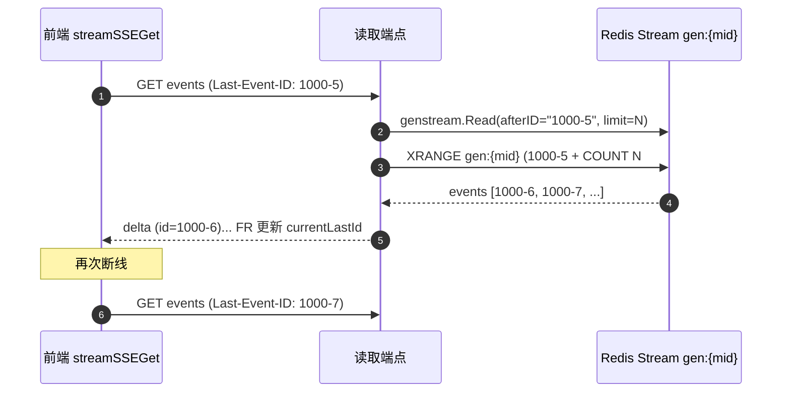

# 停止生成如何跨实例精准送达 —— 机制深析

> 场景：用户在 A 浏览器点「停止生成」，后端**可能用多个实例（无状态、可水平扩展）**，正在生成的那次 SSE 流可能跑在**另一实例**上，甚至用户自己在第二个标签页/另一设备也要同步停止。
> 本文档回答：停止信号是如何**只命中那个会话、那条消息、那次生成**，并且在多实例、有竞态的情况下**不漏发、不错停**的。
>
> 源码基准：Aivory v2.5.2-beta.12（Go 后端）。配套：《agent-subagent流程与多用户隔离分析》《后端-02-LLM编排与流式》。

---

## 0. 一句话结论

「跨实例精准送达」建立在 **Redis 三层通道**上，且刻意**不把 pub/sub 当作可靠**：

1. **主通道（实时）**：Redis Pub/Sub，topic 精确到 `(userID, conversationID, generationID/messageID)` 三级粒度，让正在生成的那个实例第一时间取消上下文（`ctx`）→ 终止 provider 流。
2. **兜底通道（防丢）**：**持久化 stop 意图标记**（`scopedStopIntentKey`，短 TTL 的 Redis key）。订阅方**先订阅、再查标记**，弥合「Stop 先到、generation 还没订阅」的竞态。
3. **最终一致性（原子）**：每个生成事件用 **Redis Lua 原子脚本**「先检查吊销墓碑、再追加到流」；一旦被吊销，后续 `Append` 返回 `revoked=true` → 正在生成的实例即使错过广播也会停止；跟随者（重连/其它设备）**回读流时读到墓碑**即发 `done(stopped)`。

多用户不错停，靠 **topic/key 全部绑定 `userID` + `conversationID`**，且 stop 端点先做会话所有权校验（`store.GetConversation(id, u.ID)`）。

---

## 1. 一组 Redis key（每个生成流的“档案”）

由 `server/internal/genstream/genstream.go` 定义（`genstream.go:20-41`）：

| Key / Topic | 形态 | 作用 |
|---|---|---|
| 事件流 | `gen:{messageID}` | 该消息的 SSE 事件按序缓存（Redis Stream，`MAXLEN ~50000`，TTL 2h） |
| 帧通知 | `gen:{messageID}:notify` | 有新事件时 pub/sub 通知跟随者回放 |
| **吊销墓碑** | `gen:{messageID}:revoked` | **已停止的持久标记（tombstone）**，原子装设 |
| **吊销广播** | `gen:{messageID}:revoked:notify` | **跨实例停止广播**，订阅方收到即取消 |
| 停止意图（scoped） | `scopedStopIntent:{topic}` | 短 TTL 的持久 stop 标记（第 4 节） |

`genstream.go:46` `Append`：`StreamAppendIfAllowed(Key(msgID), denyKeys=[RevocationKey(msgID), ...], value, TTL)`，返回 `(id, appended, revoked)`。

---

## 2. 原子基石：Redis Lua 脚本

`server/internal/cache/redis.go:44-99` 的三个 Lua 脚本，是「精准 + 不漏」的根本 —— 检查墓碑与数据变更在**同一原子步骤**内完成，杜绝「读时未删、删后被写」的竞态：

```lua
-- streamAppendIfAllowed: 先 EXIST 检查所有 deny(墓碑)，命中即拒绝；否则 XADD
for index = 2, #KEYS do
  if redis.call("EXISTS", KEYS[index]) == 1 then return {0} end
end
local id = redis.call("XADD", KEYS[1], "MAXLEN", "~", 50000, "*", "data", ARGV[1])
if tonumber(ARGV[2]) > 0 then redis.call("PEXPIRE", KEYS[1], ARGV[2]) end
return {1, id}

-- streamReadIfAllowed: 先检查墓碑；命中返回 {0}(revoked)，否则 XRANGE 读
-- streamRevoke: 原子地 SET 墓碑(PX ttl) + DEL 流内所有已缓冲帧
```

> Redis Stream + `MAXLEN ~` 提供按序、可游标（`afterID`）读取；`genstream.Read` 用 `XRANGE (afterID +` 实现断点续读（`redis.go:367-370`）。

---

## 3. 发布侧：用户点「停止」

路由：`POST /api/conversations/:id/stop`（`router.go:452`）→ `stopHandler`（`conversations_handlers.go:1615`）。



**要点**：
- **权限**：`stopHandler:1618` 先 `GetConversation(id, u.ID)` —— 用户只能停止自己有权限的会话；`1662-1665` 注释明确“workspace 成员共享会话，但不能取消彼此的生成”，故 conversation 级广播也带上 `u.ID`。
- **三级选择器**（`1630-1667`）：`generation_id`（最精准，一次生成）、`message_id`（一条助手消息）、无选择器（向后兼容，按用户+会话）。
- `revokeMessageGenerationStreams`（`messages_handlers.go:320-346`）：`genstream.Revoke`（原子装墓碑并删除已缓冲帧）+ **即使原子操作失败也 `Publish`**（让在线订阅者仍能即时停止，回复失败而不是假确认）。

---

## 4. 接收侧：正在生成的那个实例如何精准停下

生成端点（`POST .../messages` 的 SSE，`messages_handlers.go:1480-1599`）在调用 `Orchestrator.Run` 前，安装了**多个**停止闸门，全部触发 `cancel()`：

```go
// 1) 会话级：conversationStopTopic(u.ID, id) —— 任何 stop/revoke 广播
stopCh, unsub := d.Cache.Subscribe(conversationStopTopic(u.ID, id))   // 1485
go func(){ select { case <-stopCh: cancel(); case <-ctx.Done(): } }() // 1488-1493

// 2) generation 级：generationStopTopic(uid,cid,gid) + 停止意图标记
scopedStop := newGenerationStopWatcher(d, ctx, cancel, u.ID, id, req.GenerationID) // 1483
defer scopedStop.close()

// 3) message 级：在 message_start 出现、拿到持久 assistant id 后安装
//    (sendEvent 里 scopedStop.watchMessage(streamMessageID), 1522)
```

`newGenerationStopWatcher + subscribeScopedStop`（`messages_handlers.go:527-556, 904-929`）是最关键的可靠性设计：

```go
func subscribeScopedStop(d, ctx, onStop, topic) func() {
    ch, unsubscribe := d.Cache.Subscribe(topic)
    go func(){ select {
        case _, ok := <-ch: if ok { onStop() }
        case <-ctx.Done():
    }}()
    // 先订阅，再检查持久化 stop 意图标记 —— 停止若发生在订阅前，也能经标记补上
    if _, stopped := d.Cache.Get(scopedStopIntentKey(topic)); stopped { onStop() }
    return func(){ unsubscribe(); d.Cache.Delete(scopedStopIntentKey(topic)) }
}
```

`publishScopedStop`（`messages_handlers.go:904`）的注释直接点明设计动机：
> **“Pub/Sub is intentionally best-effort. The short-lived marker（scopedStopIntentKey）closes the race where Stop reaches the server before the generation has subscribed.”**

即：pub/sub 不可靠时，靠 **持久意图标记** 兜住「先停止、后订阅」的竞态。

### 防“停止过早/漏停”的细节
- `requestStop`（`:966`）：置 `stopRequested=true`，仅当已 `active` 才 `cancel()`。
- `activate`（`:980`，在 `message_start` 后调用）：置 `active=true`，若此前已请求停止则补 `cancel()` —— **防「Stop 赢了订阅竞态、把消息行/assistant 行留成半成品」**。
- `watchMessage`（`:990`，在拿到持久 assistant id 后）：安装 **message 级**订阅，把停止粒度从 generation 细化到 message。
- `sendEvent` 里的 **迟到内容拦截**（`:1533`）：`ctx.Err()!=nil` 时只放行 `message_start` 与 `done(stopped)`，**丢弃 provider 忽略取消后回传的缓冲 delta**。

```mermaid
flowchart TD
    A[用户点停止] --> B[stopHandler]
    B --> C[genstream.Revoke 装墓碑+清流]
    B --> D[publishScopedStop: 意图key + Publish topic]
    C --> E[Append[i] 检测墓碑 → revoked → cancel]
    D --> F[订阅方 subscribeScopedStop → cancel]
    F --> G[ctx cancel → Orchestrator.Run 终止 provider 流]
    E --> G
    G --> H[ctx 后只放行 done/stopped, 丢弃迟到 delta]
```

---

## 5. 回放 / 跟随者侧：其它设备重连如何也被精准停止

读取端点（`GET /api/messages/:id/events` 之类的 SSE 回放，`messages_handlers.go:2160-2258`）对**任意实例/任意设备**都成立：

1. **先订阅吊销广播再回放**：`subscribeAccessRevocationTopic(genstream.RevocationTopic(msgID))`（`:2166`）——「先订阅再回放」，并发吊销要么经通知、要么经墓碑被观察到。`subscribeAccessRevocationTopic`（`:527`）有 **fail-closed**：订阅通道非主动关闭也会 `cancel()`（“lost cross-replica subscription is security-significant… fail closed”）。
2. **墓碑兜底**：`flush()` 中 `genstream.Read` 返回 `streamRevoked=true` → 发 `done(stopped)` 并返回（`:2178-2184`）。
3. **帧通知**：订阅 `genstream.Topic(msgID)`，有新事件回放（`:2214`）。
4. **状态轮询兜底**：定时 `statusCheck` 查 DB `status != streaming` → 结束（`:2242-2255`），覆盖“即便 pub/sub 与墓碑都未命中”的极端情况。

三重兜底（广播 → 墓碑 → DB 轮询）保证：**任何实例、任何时机打开的跟随流，都会被同一停止事件正确终止**。

### 5.1 跟随者同步停止的真实时序（第二标签页 / 另一设备 / 断线重连）

跟随者是「**一开始就在读**」的跟随者，还是「**停止后才重连**」的跟随者，走不同的路径，但最终都收敛到 `done(stopped)`：



**要点**：
- **场景 B 是「精准送达」最容易漏的一环**：如果关闭的 tab 重连时停止已经发生、且它「先回放后订阅」，就可能把已停止的流当「可恢复流」续播。项目用「**先 `subscribeAccessRevocationTopic` 再回放**」（`messages_handlers.go:2166`）杜绝这一点——`flush()` 首次调用（`2201`）就会 `genstream.Read` 到墓碑并发 `done(stopped)`，**不输出任何历史 delta**（`2160-2206` 的即判逻辑）。
- **断点续传纠偏**：`genstream.Read` 用 `Last-Event-ID`（请求头或 query `last_id`，`2169-2172`）作游标，`XRANGE (afterID +` 只取增量；若是 `done/error` 这类 terminal 帧（`genstream.Terminal`），则 `flush()` 直接返回 `terminal=true` 结束（`2194`）。
- **`conversation.updated` 联动**：生成时 `publishUserEvent(d, r, u.ID, "conversation.updated", id)`（`1559`）推给用户的实时事件流，让其它标签页的会话列表/消息状态也能感知生成已结束或停止。

### 5.2 终局的三种「最后一次写」形态（谁负责向跟随者宣告结束）

| 终局形态 | 触发 | 跟随者收到 |
|---|---|---|
| 正常完成 | 生成侧发 `done` 并 `Append` | 事件流回放 `done`；DB `status` 置终态 |
| 被停止（在线跟随） | 发布 `RevocationTopic` 广播 → 跟随者 `cancel()` | `done(stopped)`（`messages_handlers.go:2230/2236`） |
| 被停止（离线重连） | 重连 `flush()` 读到墓碑 | `done(stopped)`（`2203/2218`） |
| 极端：以上都漏 | `statusCheck` 轮询 DB `status != streaming` 或 `markMessageStopping` 写的 `stopping` | `done(stopped)`（`2242-2255`） |

> 设计取的是「**至少一种通道必然命中**」：广播可能丢（无订阅者）、墓碑可能被 TTL 清掉，但只要消息在 DB 里被标记为非 `streaming`，跟随者最多延迟一个 `statusCheck` 周期（`streamStatusRecheckInterval`）必然结束。

### 5.3 断线重连游标：`Last-Event-ID` × Redis Stream 的协同

跟随者重连时不希望从头重放，而是**从上次读到的事件之后继续**。这个"从哪继续"由 **exclusive 游标** 承载：

1. **前端记录游标**：`streamSSEGet` 每次读到一帧都会 `currentLastId = frame.id`，并在请求头带 `Last-Event-ID: currentLastId`（`client.ts:595`）；服务端亦接受 query `last_id`（`messages_handlers.go:2169-2172` 优先读 header）。
2. **服务端转成 Redis 游标**：`genstream.Read(..., afterID, limit, ...)` → `StreamReadIfAllowed` 里 `start := "(" + afterID`（`redis.go:367-370`）。**前缀 `(` 表示 Redis Stream 的 "exclusive" 游标**——从大于 `afterID` 的那条开始，正好**不重发** `afterID` 这一条（它已在前一次读过），避免重复 delta。
3. **增量 + 上限**：`XRANGE key (afterID + COUNT limit`（`redis.go:373`），`limit=streamReplayBatchSize` 分批回放；超长流由前端驱动多次 `flush` 分页取完。
4. **停止后的重连**：即使带了 `Last-Event-ID`，`flush()`（`messages_handlers.go:2174-2200`）仍先经 `genstream.Read` 查墓碑——若已 `streamRevoked`，**忽略游标直接 `done(stopped)`，一条 delta 都不回放**（`2201-2206`）。游标只用于「可续播」，绝不用于「已停止」。
5. **事件 id 的唯一性**：Redis Stream 用 `XADD ... *` 生成 `{ms}-{seq}` 形式 id（`redis.go` append 脚本；内存版 `cache.go:392-393` 亦是 `{ts}-{seq}`），天然满足「单调递增、可作 exclusive 游标」的前置条件。



> **要点**：游标协议让「无限流」在多次断线后仍**逐字节不丢、不重**；而停止语义（墓碑）在游标之上**优先于**游标——一旦 `revoked`，游标被忽略、直接宣告 `done(stopped)`。

---

## 6. 多实例、多用户、多会话为什么“不混”

| 维度 | 机制 |
|---|---|
| 精准到一次生成 | generation/message topic 命名含 `userID+conversationID+genID/msgID`（`messages_handlers.go:183-188`） |
| 精准到会话 | conversation topic 含 `userID`（`conversationStopTopic(u.ID,id)`），workspace 成员不能互停 |
| 防止越权 | `stopHandler` 先 `GetConversation(id, u.ID)`（`1618`）；message 选择器校验消息属于该会话且是 assistant（`1651-1652`） |
| 原子性 | Lua 脚本内检查墓碑+变更，无“读到半状态” |
| 语境隔离 | 每生成一个独立 `context` + `cancel()`，天然不共享 |
| 实例无关 | 所有协调走 Redis，不依赖“停止”落在哪个实例 |

---

## 7. 无 Redis（个人版/开发）降级

`main.go:71-82`：`REDIS_URL` 未设则 `cache.NewMemory()`。`cache/cache.go` 的 `memory` 实现**逐个实现了与 Redis 语义对等的接口**（`StreamAppendIfAllowed`/`StreamReadIfAllowed`/`StreamRevoke`/`Subscribe`/`Publish`，`cache.go:373-463`），因此第 2 节的原子性、第 5 节的墓碑兜底逻辑在**单进程内依然成立**，只是「跨实例」退化为「跨 goroutine」。个人版用 SQLite 单实例，本就需要进程内协调，语义完全一致、零依赖。

内存实现如何在单进程内保证「原子」？（`cache.go:373-463`）
- 用一个互斥锁 `m.mu.Lock()/Unlock()` 包住整个「检查墓碑 → 变更」：
  - `StreamAppendIfAllowed`（`:373`）：遍历 `denyKeys`，若某墓碑 `entry` 未过期则返回 `revoked=true`（`:381-391`，`delete` 掉已过期的墓碑）；否则 `m.streamSeq++` 生成形如 `{ts}-{seq}` 的事件 id（`:392-393`），追加到 `m.streams[key].events`（超出 `memoryStreamEventRetentionCap` 会截断，`:399-401`）——等价 `XADD MAXLEN`。
  - `StreamReadIfAllowed`（`:407`）：同样先查墓碑，再按 `afterID` 定位游标（`:434-442`）切片读取——等价 `XRANGE (afterID +`。
  - `StreamRevoke`（`:453`）：**同时**写墓碑 `m.store[tombstoneKey]={value:"1",exp}` 并 `delete(m.streams,key)`（清空缓存流），一步完成——等价 Lua 脚本第 3 个的「SET 墓碑 + DEL 流」，原子性靠同一把锁保证（`:458-462`）。
- pub/sub：`Subscribe`/`Publish` 用进程内 channel（`cache.go:288-310`），发布在锁内广播，保证订阅者不丢消息。

> **要点**：内存实现不是「阉割版」，而是「单机版」。它把 Redis 的原子性（Lua）换成互斥锁的原子性（同一把锁内完成「查墓碑+追加/读/删」），把 pub/sub 换成进程内 channel。对 `genstream.Append/Read/Revoke` 与 `subscribeScopedStop` 的调用方而言，**行为完全一致**，这正是它能无缝降级的原因。

---

## 8. 对 Python 后端复刻的要点

1. **Redis 结构照搬**：`gen:{mid}` 用 Redis Stream（`XADD MAXLEN`/`XRANGE (id +`）；`gen:{mid}:revoked` 用带 TTL 的 key；`RevocationTopic`/`Topic` 用 pub/sub。
2. **原子脚本是灵魂**：把三个 Lua 脚本（Existence 检查墓碑 + XADD/XRANGE/DEL）原样搬到 Python 侧 `redis-py` 的 `script`（或 `EVAL`）。**不要**用“先 GET 再 XADD”两条命令（无原子性，竞态会漏停）。
3. **订阅先订阅再查标记**：实现 `subscribeScopedStop` 等价逻辑 —— `psubscribe` 后立刻 `get(scopedStopIntentKey)`；发布侧 `set(意图key, ttl) + publish`。
4. **三级 stop 选择器 + 所有权校验**：`generation_id/message_id/无选择器` 语义保留；任何 stop 前 `get_conversation(id, user_id)` 校验。
5. **迟到内容拦截**：`ctx` 取消后只放行 `done(stopped)`，丢弃 provider 缓冲的迟到 delta —— 用 FastAPI 的 `CancelledError`/`asyncio` 作准。
6. **跟随者三重兜底**：广播 + 墓碑回读 + DB 状态轮询（`asyncio` 定时任务）。

---

## 9. 参考源码

- 停止：`server/internal/api/conversations_handlers.go:1615-1668`（stopHandler）
- 发布：`messages_handlers.go:320-346`（revokeMessageGenerationStreams）、`904-929`（publishScopedStop / subscribeScopedStop / scopedStopIntentKey）
- 生成侧接收：`messages_handlers.go:1480-1599`、`generationStopWatcher`（`960-1014`）
- 跟随者回放：`messages_handlers.go:2160-2258`
- 原子脚本：`server/internal/cache/redis.go:44-99, 325-404`；内存降级 `cache/cache.go:373-462`
- 调停模块：`server/internal/genstream/genstream.go`
