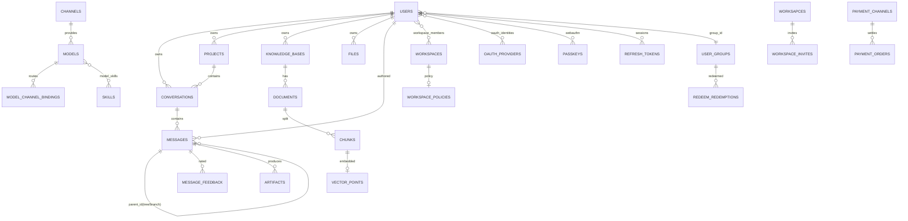

# Aivory 后端调研（05）— 数据模型与存储层

> 本篇深入调研 **Go 后端存储层**（`server/internal/store/`）与 **迁移系统**（`server/migrations/`），梳理完整领域数据模型、PG/SQLite 双后端兼容策略、SQL 组织方式与 settings 键值系统，并给出 **Python/FastAPI 复刻要点**。
> 版本基准：`v2.5.2-beta.12`，分支 `main`。
> 调研代码目录：`D:\git_codes\Aivory\server\`

---

## 0. 存储层总览（先说结论）

- **存储是一个包** `server/internal/store/`，无 ORM，全部**手写 SQL 字符串** + `database/sql` 结构体扫描。
- **无版本化迁移表机制**。`server/migrations/0001_init.sql` 只是**初始化的最小骨架**，真实心智模型是**单文件嵌入 schema**（`schema.sql` / `schema_pg.sql`）+ 一个巨型的、幂等的 `Migrate()` 函数，在**每次启动时**跑一遍，靠 `CREATE TABLE IF NOT EXISTS` + `ALTER TABLE ... ADD COLUMN`（尽力而为）+ 大量**一次性数据回填迁移**。
- **双后端（SQLite / PostgreSQL）抹平方式**不是运行时函数模拟，而是：
  1. **两套独立 schema 文件**（`schema.sql` SQLite 方言 vs `schema_pg.sql` PG 方言），按 DSN 选一个嵌入执行；
  2. **一个自定义 database/sql 驱动**（`pgcompat`），把查询里 SQLite/MySQL 风格的 `?` 占位符改写成 PG 的 `$1,$2,...`，让业务代码无需改动。
  3. `Migrate()` 内部对每个 `ALTER TABLE` 检查 `usePostgres` 布尔，切换 `ADD COLUMN` / `ADD COLUMN IF NOT EXISTS` 版本。
- **ID 不用 UUID、不用自增**，而是 `前缀_12位十六进制（48bit 随机）`，如 `co_`、`msg_`、`kb_`（见 `ids.go:15`）。只有 `usage_logs` 等极少表用 `AUTOINCREMENT`/`BIGSERIAL`。
- **JSON 一律存 TEXT / JSONB 列**，Go 侧用 `json.RawMessage` 读入，应用层再反序列化。
- **查询函数全部是包级自由函数**，第一个参数是 `*sql.DB`（或 `*sql.Tx`），**没有 `Store` 结构体**，按实体拆文件。

---

## 1. 迁移系统

### 1.1 骨架文件：`server/migrations/0001_init.sql`（324 行）

目录 `server/migrations/` 下**只有一个** SQL 文件：

| 文件 | 行数 | 内容 |
|------|------|------|
| `server/migrations/0001_init.sql` | 324 | 初始化骨架：settings / users / channels / models / skills / model_skills / knowledge_bases / projects / conversations / messages / message_feedback / files / documents / chunks / memories / usage_logs / usage_stats / artifacts / refresh_tokens，共 20 张表 |

它的卷首注释（`0001_init.sql:1-6`）直接说明双后端策略：

```sql
-- Aivory schema. SQLite-compatible; ports cleanly to Postgres (replace
-- AUTOINCREMENT with BIGSERIAL, JSON with JSONB, and add tsvector for
-- chunks). Mirrors design.md §5 — same table names and semantics, with
-- vectors and full-text dropped into the same row instead of split across
-- Qdrant + PG because we run on a single SQLite file in this build.
```

注意：**`0001_init.sql` 只是展示用途的历史骨架**，运行时代码并不读取它。运行时真正执行的是嵌入在 store 包里的**两份完整 schema**（见下）。

### 1.2 真正执行的 schema：嵌入式两份文件

`server/internal/store/store.go:22-26` 用 `//go:embed` 把两份 schema 打进二进制：

```go
//go:embed schema.sql
var schemaSQL string

//go:embed schema_pg.sql
var schemaPGSQL string
```

- `server/internal/store/schema.sql`（1383 行，SQLite 方言，**75 张表**）
- `server/internal/store/schema_pg.sql`（1302 行，PostgreSQL 方言，同表格逐列对齐）

### 1.3 驱动 / 方言选择：`store.Open`（`store.go:64-98`）

```go
func Open(dataSource string) (*sql.DB, error) {
	if isPostgresDSN(dataSource) {          // store.go:54
		usePostgres = true
		db, err := pgcompat.Open(dataSource)
		...
		db.SetMaxOpenConns(setMaxOpenConns)  // 20
		db.SetMaxIdleConns(setMaxIdleConns)  // 10
		...
		return db, nil
	}
	usePostgres = false
	db, err := sql.Open("sqlite3", dataSource)
	...
	db.SetMaxOpenConns(1) // SQLite serialises writes; keep contention low.
	...
	if _, err := db.Exec("PRAGMA foreign_keys = ON"); err != nil { ... }
	return db, nil
}
```

`isPostgresDSN`（`store.go:54-59`）通过 DSN 前缀判断：

```go
func isPostgresDSN(dsn string) bool {
	l := strings.ToLower(strings.TrimSpace(dsn))
	return strings.HasPrefix(l, "postgres://") ||
		strings.HasPrefix(l, "postgresql://") ||
		strings.Contains(l, "host=") && strings.Contains(l, "dbname=")
}
```

`usePostgres` 是包级布尔（`store.go:30`），设置一次，`Migrate()` 据此选方言。

### 1.4 启动时如何执行

`server/cmd/api/main.go:57-63`：

```go
db, err := store.Open(cfg.DatabaseURL)   // main.go:57
...
if err := store.Migrate(db); err != nil {  // main.go:62
	logger.Fatalf("store.Migrate: %v", err)
}
```

### 1.5 核心迁移函数 `Migrate`（`store.go:101` 起，函数非常庞大，近 800 行）

它不是传统的"按版本号依次执行"式迁移，而是一种**幂等、可重复执行**的迁移，每次启动整体重放。结构大致分六步：

**(1) 迁移前探测**（`store.go:102-144`）：用 `columnExists(db, table, col)`（`store.go:818` 附近实现的辅助函数，内部 `PRAGMA table_info` 或 information_schema）探测老库中某些列是否存在，以决定是否做一次性数据回填。

**(2) 定义所有增量 DDL**（`store.go:146-380`）：列出上百条 `ALTER TABLE xxx ADD COLUMN yyy ...` 字符串（SQLite 版），例如：

```go
addTotpSecret := `ALTER TABLE users ADD COLUMN totp_secret TEXT NOT NULL DEFAULT ''`
addMsgSearchText := `ALTER TABLE messages ADD COLUMN search_text TEXT NOT NULL DEFAULT ''`
addConvWorkspace := `ALTER TABLE conversations ADD COLUMN workspace_id TEXT NOT NULL DEFAULT ''`
addUsageCredits := `ALTER TABLE usage_logs ADD COLUMN credits REAL NOT NULL DEFAULT 0`
...
```

**(3) 若是 PG，把每条 DDL 换成 `ADD COLUMN IF NOT EXISTS` + 更精确的类型**（`store.go:380-541`），例如：

```go
if usePostgres {
	schema = schemaPGSQL
	addTotpSecret = `ALTER TABLE users ADD COLUMN IF NOT EXISTS totp_secret TEXT NOT NULL DEFAULT ''`
	addGenMs      = `ALTER TABLE messages ADD COLUMN IF NOT EXISTS gen_ms BIGINT NOT NULL DEFAULT 0`
	addPasskeyUserHandle = `ALTER TABLE passkeys ADD COLUMN IF NOT EXISTS user_handle BYTEA`
	...
}
```

**(4) 先执行整份 schema（幂等建表）**（`store.go:548-550`）：

```go
if _, err := db.Exec(schema); err != nil {
	return fmt.Errorf("apply schema: %w", err)
}
```

**(5) 逐个执行增量 ALTER（尽力而为，吞掉错误）**（`store.go:573-610`）：

```go
for _, ddl := range []string{
	addImageRef, addOfficialTools, ..., addPasskeyUserHandle,
} {
	_, _ = db.Exec(ddl)   // SQLite 重复列报错被忽略；PG 用 IF NOT EXISTS 天然幂等
}
```

注释（`store.go:569-572`）说明了原因：`CREATE TABLE IF NOT EXISTS` 不会给已存在的旧表加列，所以必须靠 ADD COLUMN；SQLite 没有 `IF NOT EXISTS`，重复执行会报 "duplicate column"，这里吞掉；PG 用 `IF NOT EXISTS`，干净 no-op。

**(6) 大量一次性数据回填 + 触发器等**（`store.go:611` 起）：`backfillModelChannelConfiguration`、`migrateLegacyModelTTFT`、`UPDATE workspace_members SET role='admin' WHERE role='owner'`、`dropLegacyChunkEmbeddingColumn`、`BackfillUsageStats` 等几十个迁移函数串联执行。每个迁移自带**幂等保护**（`if not columnExists` / settings 标记 / resource_lifecycle_migrations 表）。

### 1.6 「列对齐守卫」（column-parity guard, `store.go:751-814`）

由于 ADD COLUMN 循环把错误吞掉（SQLite），一旦静默失败会导致运行时 `no such column`。Migrate 末尾对**每张被迁移过的表**用 `SELECT col1,col2,... FROM table WHERE 1=0` 做存在性断言，失败即启动中止：

```go
columnChecks := map[string][]string{
	"messages": {"credits","model_label","search_text","gen_ms","feedback","verify","author_id",...},
	"models":   {"official_tools","builtin_tools","mcp_server_ids","denied_group_ids","moderation_enabled",...},
	...
}
for table, cols := range columnChecks {
	if _, err := db.Exec(fmt.Sprintf(`SELECT %s FROM %s WHERE 1=0`, strings.Join(cols, ", "), table)); err != nil {
		return fmt.Errorf("schema column check failed for %q ...", table, err)
	}
}
```

### 1.7 唯一真正"版本化"的记录表：`resource_lifecycle_migrations`

大部分一次性迁移用 `columnExists` 或 settings 标记幂等；但 `resource_lifecycle.go` 引入了一个真正的 `resource_lifecycle_migrations(key TEXT PRIMARY KEY)` 表（`schema.sql:1141`）来记录已执行的一次性任务，例如标记 `avatar_ownership_v1`（`resource_lifecycle.go:10-63`）：

```go
func migrateResourceLifecycles(db *sql.DB) error {
	if _, err := db.Exec(`CREATE TABLE IF NOT EXISTS resource_lifecycle_migrations (key TEXT PRIMARY KEY)`); err != nil { ... }
	// PG: 创建删除触发器；SQLite: 创建同语义触发器
	...
	if err := db.QueryRow(`SELECT COUNT(*) FROM resource_lifecycle_migrations WHERE key='avatar_ownership_v1'`).Scan(&backfilled); err != nil { ... }
	if backfilled == 0 {
		if err := BackfillManagedAvatarOwnership(context.Background(), db); err != nil { ... }
		if _, err := db.Exec(`INSERT INTO resource_lifecycle_migrations(key) VALUES('avatar_ownership_v1') ON CONFLICT(key) DO NOTHING`); err != nil { ... }
	}
	return nil
}
```

这是 Aivory 里与主流迁移框架最接近的机制：**用 key 记录"已执行"，幂等防重放**。但注意：这个表只用于**数据迁移（backfill）**和触发器安装，**不用于 DDL 建表/加列**。

> **小结**：Aivory 的迁移 = 「分号分隔的整份 schema（IF NOT EXISTS）」+「ADD COLUMN 增量列表」+「一次性数据回填函数串」+「列守卫」。没有任何 `schema_migrations` 版本表来记录历史 DDL。

---

## 2. 核心表结构（完整领域数据模型）

`schema.sql` 共定义 **75 张表**（`grep -c "CREATE TABLE"` 计 75）。下面按领域分组列出核心表及关键字段。

### 2.1 表清单（核心表)

| # | 表名 | 用途 | 关键字段（PG 类型） |
|---|------|------|--------------------|
| 1 | `settings` | 全局键值配置，value 为 JSON 字符串 | `key` TEXT PK, `value` TEXT(JSON), `updated_at` BIGINT |
| 2 | `users` | 用户账号 | `id` TEXT PK, `email` UNIQUE, `password_hash`, `role`, `status`, `token_ver`, `settings`(JSON), `group_id`→user_groups, `totp_secret`/`totp_enabled`, `password_set`, `password_changed_at`, `last_seen_at`, `credits_permanent_micros`, `credit_cycle_anchor`, `quota_cycle_anchor`, `sort_order`, `created_at` |
| 3 | `site_notifications` + `site_notification_states` | 站内公告（enable/version）及每用户已读/关闭版本号 | `version` TEXT, `enabled`; states: `(user_id, notification_id, read_version, dismissed_version)` |
| 4 | `channels` | 上游服务商（openai/claude/gemini/mock） | `type`, `api_format`(chat/responses), `base_url`, `api_key`, `headers`(JSON), `auto_disable_*`, `consecutive_*`, `auto_disabled_until` |
| 5 | `models` | AI 模型目录（挂 channel 下） | `channel_id` FK, `kind`(chat/image/embedding), `request_id`, `label`, `tool_mode`, `vision`, `stream`, `extra_params`(JSON), `official_tools`, `builtin_tools`, `price_input/output/cache_*`, `currency`, `dim`, `tags`(JSON), `protocol`, `fast`, `fallback_channel_id`, `moderation_*`, `research_enabled` |
| 6 | `channel_models` | 渠道已发现/手动模型快照 | `channel_id`, `request_id`, `label`, `source`(manual/…) |
| 7 | `model_channel_bindings` | 多通道负载/故障转移绑定 | `model_id`, `channel_id`, `role`(regular/…), `priority`, `weight`, `consecutive_*`, `disabled_until` |
| 8 | `model_tags` | 模型标签 | `name` UNIQUE(lower) |
| 9 | `mcp_servers` | 管理员 MCP Streamable HTTP 服务 | `url`, `headers`(JSON), `enabled`, `discovered_tools`(JSON), `disabled_tools` |
| 10 | `skills` / `model_skills` | 内置技能目录 + 模型-技能多对多 | skills 有 `instructions`, `assets`(JSON); model_skills 复合主键 `(model_id, skill_id)` |
| 11 | `prompts` / `user_skills` / `user_prompts` / `user_mcp_servers` | 提示词库 + 用户私有技能/提示词/MCP | 均带 `workspace_id`（个人或工作区作用域）、`source_skill_id` 等 |
| 12 | `user_groups` | 会员/订阅层级（套餐） | `name`, `features`(JSON), `monthly_price_amount_minor`, `yearly_price_amount_minor`, `max_projects`, `max_kbs`, `max_storage_mb`, `credit_allowance_micros`, `credit_period_seconds`, `is_default`, `is_purchasable`, `permissions`(JSON) |
| 13 | `knowledge_bases` | 知识库 | `user_id` FK, `name`, `embedding_model_id` FK, `embedding_dim`, `project_id`, `workspace_id`, `is_public` |
| 14 | `knowledge_base_shares` + `workspace_kb_member_permissions` | KB 共享 + KB 级成员覆写权限 | shares `(kb_id,user_id,role)`; perms `(kb_id,user_id,can_add_files,can_delete_content)` |
| 15 | `projects` | 项目容器 | `user_id`, `name`, `instructions`, `accent`, `emoji`, `pinned`, `kb_id`, `auto_add_uploads`, `workspace_id`, `is_public` |
| 16 | `conversations` | 会话 | `user_id`, `project_id`, `title`, `provider`, `model_id`, `fast`, `kb_ids`(JSON), `rag_mode`, `summary_blocks`(JSON), `active_leaf_id`, `provider_state`(JSON), `pinned/archived/starred`, `inline_source_conv/parent_id/quote`, `workspace_id`, `is_public`, `draft_scope` |
| 17 | `messages` | 消息（树/链表结构） | `conversation_id` FK, `parent_id` FK(self), `role`, `provider`, `model_id`, `model_label`, `blocks`(JSON), `raw`, `stop_reason`, `attachments`(JSON), `citations`(JSON), `input/context/output/cache_read/cache_write_tokens`, `cost`, `currency`, `credits`, `status`, `error`, `gen_ms`, `search_text`, `fast`, `selected_user_skill_ids`(JSON), `author_id`, `verify`, `created_at` |
| 18 | `conversation_compaction_leases` / `conversation_generation_leases` | 紧凑/生成的分布式租约 | 防止并发重复压测/生成的锁表 |
| 19 | `message_feedback` | 消息质量反馈（点赞/点踩） | `message_id`, `user_id` UNIQUE, `workspace_id`, `model_id`, `channel_id`, `rating` CHECK(in like/dislike), `reasons`(JSON), `comment` |
| 20 | `user_feedback` | 用户产品问题工单 | `description`, `page_path`, `user_agent`, 截图 `screenshot`(BYTEA) |
| 21 | `files` | 上传文件（会话/项目附件） | `user_id`, `conversation_id`, `filename`, `mime_type`, `size_bytes`, `storage_path`, `provider_refs`(JSON), `kind`, `draft`, `branch_message_id`, `rel_path`, `vision_evidence`, `vision_evidence_key` |
| 22 | `documents` | 知识库文档（入库记录） | `kb_id`, `conversation_id`, `filename`, `status`(pending/parsing/embedding/ready/failed), `chunk_count`, `storage_path`, `ingest_updated_at`, `uploaded_by_user_id` |
| 23 | `chunks` | 文档切块（RAG 文本块） | `document_id` FK, `kb_id`, `conversation_id`, `seq`, `parent_id`, `chunk_type`(text/parent/table/image_caption), `content`, `image_ref`, `meta`(JSON), `embedding_model` |
| 24 | `vector_points` | 个人版内嵌向量（主键 chunk_id+dimension）；生产 Qdrant 版留空 | `chunk_id` FK, `dimension`, `embedding` BLOB |
| 25 | `memories` | 用户长期记忆 | `user_id`, `memory_text`, `memory_type`, `slot`, `value`, `status`(ACTIVE…), `confidence`, `source_message_ids`, `supersedes/superseded_by`, `valid_from/until` |
| 26 | `tool_call_logs` | 工具调用日志 | 工具名、入参/出参轨迹（审计） |
| 27 | `usage_logs` | 原始用量日志（可被清理） | `user_id`, `conversation_id`, `message_id`, `model_id`, `purpose`(chat/task/image/embedding), `input/output/cache_* tokens`, `images_count`, `cost`, `currency`, `credits`, `workspace_id`, `channel_id`, `fallback`, `status`, `error`, `request_method/url/headers/body`, `ttft_fallback_model`, `first_byte_ms`, `duration_ms` |
| 28 | `usage_stats` | 用量统计镜像（billing 层，不被清理） | 同 usage_logs + `source_log_id` PK |
| 29 | `billing_usage` | 计费用量（固定点 cost_micros） | `cost_micros`, `images_count`, `input/output_tokens` |
| 30 | `credit_ledger` | 积分流水总账（计费记录，不删） | `user_id`, `group_id`, `cycle_anchor/start`, `kind`(timed/permanent_debit), `amount_micros`, `source_type/source_id` |
| 31 | `credit_reservations` | 积分预占 | `amount_micros`, `actual_micros`, `status`, `expires_at` |
| 32 | `quota_ledger` | 令牌/成本配额账本 | `scope_type`, `model_id`, `group_id`, `cycle_anchor`, `window_start`, `limit_type`(count/cost), `reserved_micros`, `actual_micros`, `status`, `expires_at` |
| 33 | `credit_packages` | 永久积分充值套餐 | `credits`, `price_amount_minor`, `enabled` |
| 34 | `payment_channels` / `payment_methods` | 支付渠道/支付方式 | channel `config`(JSON), `environment`(live/test) |
| 35 | `payment_orders` | 支付订单（含对账） | `amount_minor`, `tax_amount_minor`, `paid_amount_minor`, `provider_amount_minor`, `currency`, `provider`(alipay/wechat/waffo…), `status`, `environment`, `provider_payment_id`, `checkout_session_id/url/expires_at`, `last_reconciled_at`, `reconcile_error` |
| 36 | `payment_order_attempts` / `payment_events` | 订单尝试/支付事件流 | 重试与 webhook 事件 |
| 37 | `redeem_codes` / `redeem_redemptions` | 兑换码（发组/发积分） | `kind`(group/credits), `credits`, `token`; redemptions 记录兑换 |
| 38 | `artifacts` | 生成产物（图片/文件） | `message_id` FK, `filename`, `storage_path`, `mime_type`, `size_bytes`, `source`(image_gen/python_execute) |
| 39 | `conversation_shares` / `html_preview_shares` | 会话分享 / HTML 预览分享（含 token） | 分享链接、`token`、过期 |
| 40 | `refresh_tokens` | 刷新令牌 / 会话族 | `jti` PK, `session_id`(family), `user_id`, `expires_at`, `revoked`, `user_agent`, `ip`, `location`, `last_seen`, `created_at` |
| 41 | `login_histories` | 登录历史 | 用户、IP、UA、时间 |
| 42 | `oauth_providers` | 第三方登录提供方（google/github/apple/wecom/oidc） | `kind`, `name`, `client_id`, `client_secret`, `issuer_url`, `jwks_url`, `auth_url/token_url/userinfo_url`, `scopes`, `team_id`, `key_id`, `subject_namespace` |
| 43 | `oauth_identities` | Provider subject ↔ 本地用户关联（主键 provider_id+subject） | `provider_id`, `subject`, `user_id` |
| 44 | `passkeys` | WebAuthn 通行密钥 | `user_id`, `credential_id` UNIQUE, `public_key`, `user_handle`, `sign_count`, `authenticator_flags`, `name` |
| 45 | `registration_domains` / `registration_domain_matches` / `domain_users` | 企业域名注册管控 | domain 白名单规则、匹配、域内用户标记 |
| 46 | `workspaces` | 工作区 | `name`, `icon_url`, `owner_id`, `invite_token`, `deleting` |
| 47 | `workspace_members` | 工作区成员 + RBAC（18+ 个布尔权限 + role） | `workspace_id`+`user_id` PK, `role`(admin/member/guest), `can_*` 权限列 |
| 48 | `workspace_invites` | 邀请 | `token`, `email`, `role`, `expires_at`, `max_uses`, `used_count`, `created_by`, `purpose` |
| 49 | `workspace_policies` | 工作区能力策略（只能收窄） | `allowed_model_ids/tool_ids/mcp_server_ids`(JSON), `allow_sandbox/image_generation/tool_calling/drawing/mcp/skills/prompts/...`, `member_monthly_credit_limit` |
| 50 | `workspace_audit_logs` / `admin_audit_logs` | 工作区/管理审计日志 | 动作、actor、metadata(JSON，明确不含令牌/密钥/正文) |
| 51 | `workspace_announcements` | 工作区公告 | `config`(JSON), `version`, `updated_by` |
| 52 | `aippt_decks` | AI PPT 生成记录 | `user_id`, `workspace_id`, 文件引用 |
| 53 | `image_styles` | 图像生成样式 | `name`, 隐藏 prompt |
| 54 | `avatar_objects` | 头像对象生命周期（异步清删） | `user_id`, `state`, `expires_at`, `write_until`, `attempts` |
| 55 | `pending_storage_cleanup` / `pending_sandbox_cleanup` / `pending_vector_cleanup` / `document_vector_writes` | 异步清理/排队写向量 | 崩溃恢复用的重试工作队列 |
| 56 | `resource_lifecycle_migrations` | 一次性数据迁移标记 | `key` PK |
| 57 | `credit_adjustment_notifications` / `site_notification_states` 等 | 通知/状态 | — |

> **关键建表片段**（`schema.sql:25-46`，users 表）：
> ```sql
> CREATE TABLE IF NOT EXISTS users (
>   id            TEXT PRIMARY KEY,
>   email         TEXT UNIQUE NOT NULL,
>   password_hash TEXT NOT NULL,
>   role          TEXT NOT NULL DEFAULT 'user',
>   status        TEXT NOT NULL DEFAULT 'active',
>   token_ver     INTEGER NOT NULL DEFAULT 0,
>   settings      TEXT NOT NULL DEFAULT '{}',
>   group_id      TEXT NOT NULL DEFAULT 'ug_free',
>   totp_secret   TEXT NOT NULL DEFAULT '',
>   credits_permanent_micros INTEGER NOT NULL DEFAULT 0,
>   credit_cycle_anchor INTEGER NOT NULL DEFAULT (strftime('%s','now')),
>   created_at    INTEGER NOT NULL DEFAULT (strftime('%s','now'))
> );
> ```

### 2.2 ER 概览（文字）

核心实体关系（箭头 = 外键引用）：

```
users ──1:N── conversations ──1:N── messages (parent_id 自引用形成树/分支)
  │                      │                        │
  │                      └──1:N── artifacts        └──1:N── message_feedback
  ├──1:N── oauth_identities(provider_id+subject)
  ├──1:N── passkeys / refresh_tokens / login_histories
  ├──1:N── projects ──1:N── conversations
  ├──1:N── knowledge_bases ──1:N── documents ──1:N── chunks ──1:1?── vector_points
  ├──1:N── files / memories / usage_logs / usage_stats / credit_ledger
  ├──N── user_groups (membership, via users.group_id)
  ├──N── workspaces (owner_id / workspace_members 多对多)
  ├──N── oauth_providers (通过 oauth_identities 多对多)
workspaces ──N:N── users (workspace_members 中间表, 含 role 与权限列)
  ├──1:N── workspace_invites / workspace_policies(1:1) / workspace_audit_logs / announcements
  ├── projects/kbs/conversations 带 workspace_id 归入某工作区
channels ──1:N── models ──N:N── skills (model_skills)
  └──1:N── channel_models / model_channel_bindings
payment_channels ──1:N── payment_orders ──1:N── payment_events/attempts
user_groups ──1:N── redeem_redemptions / quota_ledger / credit_ledger
```

### 2.3 mermaid 简化图（core 子集）



---

## 3. pgcompat：PG / SQLite 双后端如何抹平差异

### 3.1 定位与核心思路

`server/internal/store/pgcompat/pgcompat.go:1-14` 的包注释明确其定位：

> 代码库里每个查询都用 `?` 占位符（SQLite/MySQL 惯例）。PG 需要 `$1,$2,...`。与其改每个查询串，这个包注册了一个**薄 database/sql 驱动**，包装 pgx 的 stdlib 驱动，在通过时重写占位符——就是 sqlx.Rebind 的技巧，但在**驱动边界**做，应用代码继续传 `?`。

**关键认知**：pgcompat **不实现任何"函数兼容"**（没有 now()、json_extract、全文检索之类的 SQL 函数抹平）。JSON 提取、全文检索这些差异**根本不发生**——因为：

- **JSON 一律当作不透明 TEXT/BYTEA 字符串**存，应用层用 `json.RawMessage` 解析，SQL 里不做 JSON 函数提取（即便是 PG 的 JSONB 列，也只做整存整取）。
- **全文检索不是 tsvector/FTS**，而是**冗余的 `search_text` 列 + `LOWER(like)` 子串匹配**（见 §3.3），两种方言一致。
- **SQLite 与 PG 的方言差异完全靠两套 schema 文件吸收**（strftime→extract(epoch)、INTEGER→BIGINT、REAL→DOUBLE PRECISION、AUTOINCREMENT→BIGSERIAL、JSON→JSONB、BLOB→BYTEA）。

所以 pgcompat 真正做的是**两件事**：`?`→`$n` 占位符重写，以及在驱动层透传。

### 3.2 驱动实现（`pgcompat.go:39-106` 重写函数 + 108-193 驱动包装）

`Rebind`（`pgcompat.go:39-106`）：把 `?` 依次改写成 `$1,$2,...`，且**占位符感知**——跳过单引号字符串字面量、`--` 行注释、`/* */` 块注释，正确处理 `''` 转义：

```go
func Rebind(query string) string {
	if !strings.ContainsRune(query, '?') {
		return query
	}
	var b strings.Builder
	n := 0
	for i := 0; i < len(query); i++ {
		switch c := query[i]; c {
		case '\'':  // 单引号字面量：原样拷贝到闭合引号，处理 '' 转义
			... 
		case '-':   // -- 行注释
			...
		case '/':   // /* */ 块注释
			...
		case '?':
			n++
			b.WriteByte('$')
			b.WriteString(strconv.Itoa(n))
		default:
			b.WriteByte(c)
		}
	}
	return b.String()
}
```

驱动包装（`pgcompat.go:108-193`）：定义 `connector` → `conn` 结构，实现 `driver.Conn` 接口，在 `Prepare` / `PrepareContext` / `QueryContext` / `ExecContext` 里对 SQL 先跑 `Rebind` 再交给底层 pgx 连接，同时透传 `CheckNamedValue`、`Ping`、`BeginTx`、`ResetSession`、`IsValid`。

`Open`（`pgcompat.go:29-36`）用 `pgx.ParseConfig` 解析 DSN，`stdlib.GetConnector` 拿到底层 connector，再包一层 `&connector{base: ...}`：

```go
func Open(dsn string) (*sql.DB, error) {
	cfg, err := pgx.ParseConfig(dsn)
	...
	base := stdlib.GetConnector(*cfg)
	return sql.OpenDB(&connector{base: base}), nil
}
```

### 3.3 全文索引的真相（`search.go`）

检索不使用 tsvector/FTS。写入消息时把可见文本压成一个 `search_text` 列（`search.go:17`），搜索时用 `LOWER(s) LIKE ? ESCAPE '\'` 做大小写不敏感子串匹配：

```go
// search.go:143-156
// Content hits — scan the small search_text column.
`SELECT m.conversation_id, c.title, m.id, m.role, m.search_text, m.created_at, c.updated_at
   FROM messages m JOIN conversations c ON c.id = m.conversation_id
  WHERE ... AND c.archived=0 AND c.inline_source_conv='' AND m.search_text<>''
    AND LOWER(m.search_text) LIKE ? ESCAPE '\'`
```

`search.go:89` 提供 `likeEscape` 转义用户输入中的 `%`/`_` 通配符。**PG 版同样用 LIKE 而非 trigram/tsvector**，因此两后端行为一致，无需兼容函数。向量检索走 Qdrant（生产）或 `vector_points` 表（个人版，SQLite），与 SQL 全文无关。

### 3.4 PG vs SQLite 方言映射表（依据 `schema_pg.sql:1-16` 头注释 + Migrate 的 `usePostgres` 分支）

| SQLite | PostgreSQL | 说明 |
|--------|-----------|------|
| `strftime('%s','now')` | `(extract(epoch from now())::bigint)` | 默认时间戳 |
| `INTEGER`（时间戳/字节/数量） | `BIGINT` | 避免 2038 与 token 大数溢出 |
| `REAL` | `DOUBLE PRECISION` | 价格/成本 |
| `AUTOINCREMENT` | `BIGSERIAL` | 仅 usage_logs 等 |
| `TEXT`（存 JSON） | `TEXT`（多数）或 `JSONB`（feedback.reasons 等少数） | 应用层统一按字符串读写 |
| `BLOB` | `BYTEA` | passkeys.credential_id, user_feedback.screenshot, vector_points.embedding |
| `ADD COLUMN` | `ADD COLUMN IF NOT EXISTS` | Migrate 增量 DDL 差异 |
| 布尔列 `INTEGER ... DEFAULT 1` | 相同 `INTEGER ... DEFAULT 1` | **刻意保留**：Go 层用 `int` 本地变量读、`==1` 判断（见 schema_pg.sql:14-16 注释） |

---

## 4. SQL 组织方式

### 4.1 组织原则

- **按实体拆文件**，如 `users.go`、`conversations.go`、`models.go`、`kbs.go`、`workspaces.go`、`payments.go`、`credits.go`、`oauth.go`、`passkeys.go`、`mcp_servers.go` 等（每个文件对应一个领域实体/聚合）。
- **函数全部是包级自由函数**，签名统一 `func Xxx(ctx context.Context, db *sql.DB, ...)`，第一个参数是 `*sql.DB` 或 `*sql.Tx`。**没有 `Store` 结构体/接口**——这使得查询层与数据库连接解耦，任何调用方拿到 `*sql.DB` 就能用任意函数。
- **手写 SQL 字符串**，不用 GORM/sqlx（只依赖标准库 `database/sql` + `pgcompat`）。
- **模型是扁平 struct**，字段带 JSON tag（`store.go:1-6` 注释：*every model is a flat struct with JSON-tagged exports*）。实体 struct 集中定义在 `models.go`（如 `Conversation` 在 `models.go:481`）。
- **扫描模式**：每个读取函数配一个 `scanXxx` helper，手动 `row.Scan(&a,&b,...)`，JSON 列先扫成 `string` 再转 `json.RawMessage`，布尔列扫成 `int` 再 `== 1`。

### 4.2 典型查询形态（`conversations.go:299-333`）

```go
func GetConversation(ctx context.Context, db *sql.DB, id, userID string) (*Conversation, error) {
	args := []any{id}
	args = append(args, workspaceResourceAccessArgs(userID)...)
	row := db.QueryRowContext(ctx,
		`SELECT c.id, c.user_id, COALESCE(c.project_id, ''), c.title, c.provider, c.model_id,
		        c.fast, c.kb_ids, c.rag_mode, c.summary_blocks, COALESCE(c.active_leaf_id, ''),
		        c.provider_state, c.pinned, c.archived, c.starred, c.created_at, c.updated_at,
		        COALESCE(c.inline_source_conv, ''), COALESCE(c.inline_parent_id, ''),
		        COALESCE(c.inline_quote, ''), COALESCE(c.workspace_id, ''), c.is_public,
		        COALESCE(u.name,''), COALESCE(u.settings,''), `+conversationDraftSelect("c")+`
		 FROM conversations c LEFT JOIN users u ON u.id = c.user_id
		 WHERE c.id=? AND `+conversationResourceAccessPredicate("c"), args...)
	c, err := scanConversationWithCreator(row)
	if errors.Is(err, sql.ErrNoRows) {
		return nil, ErrNotFound
	}
	...
	return &c, nil
}
```

对应的扫描 helper（`conversations.go:327-355`）展示了 JSON/布尔转换手法：

```go
func scanConversationWithCreator(s scanner) (Conversation, error) {
	var c Conversation
	var pinned, archived, starred, fastI, publicI, draftI int
	var kbIDs, sumBlocks, provState, settings string
	if err := s.Scan(&c.ID, &c.UserID, &c.ProjectID, &c.Title, /* ... */); err != nil {
		return c, err
	}
	c.Pinned = pinned == 1
	...
	c.KBIDs = json.RawMessage(orDefault(kbIDs, "[]"))          // JSON 列先扫成 string
	c.SummaryBlocks = json.RawMessage(orDefault(sumBlocks, "[]"))
	c.ProviderState = json.RawMessage(orDefault(provState, "{}"))
	c.CreatorAvatar = avatarFromSettings(settings)
	return c, nil
}
```

其他典型特征：
- **权限谓词拼接**：`conversationResourceAccessPredicate("c")`、`workspaceResourceAccessArgs(...)` 这类**动态 SQL 片段拼接**用于在 WHERE 里注入行级访问控制（个人 vs 工作区 vs 共享）。
- **写事务**：用 `db.BeginTx` / `tx.ExecContext`，部分函数接受 `*sql.Tx` 做复合操作。
- **`?` 占位符**统一。

---

## 5. settings 键值配置系统

### 5.1 表结构（`schema.sql:19-23`）

```sql
CREATE TABLE IF NOT EXISTS settings (
  key        TEXT PRIMARY KEY,
  value      TEXT NOT NULL,                  -- JSON-encoded
  updated_at INTEGER NOT NULL DEFAULT (strftime('%s','now'))
);
```

**value 存的是 JSON 序列化后的字符串**（可以是标量、对象、数组），不是裸文本。

### 5.2 读写函数（`models.go:801-835`）

`GetSetting`（`models.go:801-818`）——读取，返回 `json.RawMessage`：

```go
func GetSetting(db *sql.DB, key string) (json.RawMessage, error) {
	if val, missing, ok := settingsCacheGet(key); ok {   // 命中缓存
		if missing { return nil, sql.ErrNoRows }
		return val, nil
	}
	var raw string
	err := db.QueryRow("SELECT value FROM settings WHERE key=?", key).Scan(&raw)
	if err != nil {
		if err == sql.ErrNoRows {
			settingsCachePut(key, nil, true)              // 负缓存不存在的 key
		}
		return nil, err
	}
	settingsCachePut(key, json.RawMessage(raw), false)
	return json.RawMessage(raw), nil
}
```

`SetSetting`（`models.go:823-835`）——写入（upsert）：

```go
func SetSetting(db *sql.DB, key string, value any) error {
	b, err := json.Marshal(value)
	...
	_, err = db.Exec(`INSERT INTO settings(key, value, updated_at) VALUES(?, ?, ?)
		ON CONFLICT(key) DO UPDATE SET value=excluded.value, updated_at=excluded.updated_at`,
		key, string(b), time.Now().Unix())
	if err == nil {
		invalidateSettingKey(key)   // 本实例立即失效该 key
	}
	return err
}
```

### 5.3 进程内 TTL 缓存（`settings_cache.go`）

`settings_cache.go:9-26` 定义 `settingsCacheTTL = 15 * time.Second`，用 `map[string]settingEntry` + `sync.RWMutex` 缓存，每个条目标记过期时间与 "missing"（负缓存）：

```go
var settingsCacheTTL = 15 * time.Second

type settingEntry struct {
	val     json.RawMessage
	missing bool // negative cache: the key has no row
	exp     int64
}

var (
	settingsMu    sync.RWMutex
	settingsStore = map[string]settingEntry{}
)
```

缓存语义：
- **读**：命中且未过期直接返回；未过期 "missing" 直接返回 `sql.ErrNoRows`；否则回源 DB 并写缓存。
- **写**：`SetSetting` 成功后 `invalidateSettingKey(key)` 立刻删掉该 key 缓存。
- **跨实例失效**：`InvalidateConfig()`（`settings_cache.go:55-59`）清空整个缓存，由 main 里订阅的 `"cfg:invalidate"` Pub/Sub 触发（一处 admin 改配置，全节点清缓存；见 `settings_cache.go:11-14` 注释）。
- **只缓存 settings 表**；channels/models 走单一索引查询不对象缓存（`settings_cache.go:52-53` 注释）。

另外，`IsRetiredSettingKey`（`store.go:39`）维护 `retiredSettingKeys` map，Migrate 结束时 `DELETE FROM settings WHERE key IN (...)` 清理废弃配置（`store.go:560-568`），备份导入导出也据此丢弃。

---

## 6. 其他存储机制速览

- **资源/异步清理**：`resource_lifecycle.go` 在两种方言下分别安装删除触发器（PG plpgsql 函数 + trigger；SQLite `CREATE TRIGGER`），把删除动作排入 `pending_*_cleanup` 表，由后台任务异步执行（如清理 Qdrant 向量、对象存储、沙箱容器）。`document_vector_writes` 用于在外部写向量前给源行加短暂行锁，防止与删除竞争。
- **租约（leases）**：`conversation_compaction_leases`、`conversation_generation_leases`、`generation_leases.go`、`compaction_leases.go` 用行锁/租约防并发。
- **备份**：`backup.go`（22KB）实现 schema + 数据 + 存储文件 的逻辑备份/恢复，读 schema 表清单做 engine-agnostic 导出。
- **用量镜像**：`usage_logs` 可被清理，但 `EnableUsageStatsMirror` / `BackfillUsageStats` 会把聚合镜像到 `usage_stats`（billing 层，不被清理），`billing_usage` 也是固定点计费冗余。

---

## 7. Python 复刻要点

以下针对「把 Go 后端换成 Python/FastAPI」的场景，给出存储层与数据模型的复刻方案。

### 7.1 技术上选型

- **ORM**：建议 **SQLAlchemy 2.0 async**（`asyncpg`/`aiosqlite`）或 **SQLModel**（SQLAlchemy 上层，适合 FastAPI 快速开发）。考虑到 Aivory 大量 **JSON-in-TEXT、动态 SQL 权限谓词、行列级 RBAC** 与"扁平 struct"风格，**SQLAlchemy 2.0 `Mapped`/`mapped_column` + `select()` 构建器 + `session.execute(text(...))` 兜底手写 SQL** 最贴合原设计。若想少写、快速，选 **SQLModel**。
- **迁移**：**Alembic**。理由：Aivory 原本没有版本化迁移，但 Python 复刻**应该**用 Alembic 补充标准的 `version_table`（`alembic_version`）机制，避免重蹈"巨型幂等 Migrate 每次启动重放"的脆弱性。
- **驱动兼容**：用 **SQLAlchemy 方言**天然支持双后端，不必像 pgcompat 那样自研驱动重写占位符。SQLAlchemy 的 `?`/`%s`/`:name` 差异由编译层吸收，`text()` 亦如此。可用**同一套模型 + 方言差异配置**。

### 7.2 ID 方案（看原文）

原文**绝大多数字段用 `TEXT` 主键，形如 `前缀_12位hex`**（48bit 随机）——**不是 UUID，也不是 UUIDv4**，见 `ids.go:15-19`：

```go
func genID(prefix string) string {
	var b [6]byte
	_, _ = rand.Read(b[:])
	return prefix + "_" + hex.EncodeToString(b[:])
}
```

例如 `co_ab12cd34ef56`、`msg_...`、`kb_...`。分享 token 用 24 字节（192bit）hex（`ids.go:27-31`），兑换码用 Crockford base32 `XXXX-XXXX-XXXX`（`ids.go:42-55`）。

**Python 建议**：保持同样的语义（前缀 + 随机短 ID），可用 `secrets.token_hex(6)` 生成 12 hex 字符，或干脆换成 UUID（`uuid4().hex`），但注意**前端可能依赖短 ID 格式/长度**。SQLAlchemy 侧给每个模型 `id: Mapped[str] = mapped_column(primary_key=True, default=lambda: gen_id("co"))`。若想彻底换 UUID，需同步改前端解析。**个人推荐保留 `前缀_hex` 格式**以最小化复刻差异，主键列一律 `String`（PG 里 `VARCHAR`/`TEXT`）。

### 7.3 时间戳与类型映射

- 时间戳：原文存 **Unix 秒整数**（`INTEGER`/`BIGINT`），默认 `strftime('%s','now')`（PG: `extract(epoch from now())::bigint`）。**建议 Python 复刻直接用 `DateTime(timezone=True)`**（`datetime.now(timezone.utc)`），语义更清晰，Alembic 老库迁移时注意把旧秒整数转 datetime（或在模型里写 `server_default=func.extract('epoch', func.now()).cast(BigInteger)` 保持等价）。若想旧库平滑迁移，可保留秒整数 + `fromtimestamp` 帮助函数。
- JSON 列：原文存 `TEXT`/`JSONB`。**Python 建议统一 `JSON` 类型**（SQLAlchemy 在 SQLite 映射 TEXT、PG 映射 JSONB），数据库方言自动处理。
- 布尔列：原文 `INTEGER 0/1`。Python 用原生 `Boolean`（SQLAlchemy 在 SQLite 映射 0/1、PG 映射 BOOLEAN），但在旧库迁移时要留意现有 0/1 数据。
- 金额/积分：原文用 `REAL`/`DOUBLE PRECISION` + 固定的 `*_micros` 整数列（如 `credits_permanent_micros`、`cost_micros`、`amount_micros`）做权威值。**Python 建议：一律用整数的 `*_micros` 或 `Decimal` 存金额，避免浮点误差**。

### 7.4 迁移策略：如何把现有 SQL 迁移转成 Alembic

**思路（推荐）**：不要逐字翻译那份 800 行幂等 `Migrate`。改为：

1. **以 `schema.sql`（或 schema_pg.sql）的当前形态为"最终态"**，写**一个基线 Alembic 迁移**（`0001_initial`）——它包含全部 75 张表的 `op.create_table(...)`。这一步把"已建成"的 schema 固化为官方基线。
2. **把原来的增量 ADD COLUMN 列表**（`store.go:146-541` 那些 `ALTER TABLE ... ADD COLUMN`）改写成**各自独立的 Alembic 版本迁移** `op.add_column(...)`，按添加顺序编号，作为初始库可能缺失的用户升级路径。或用 `upgrade()` 里对每列做 `op.add_column` + `inspect` 判断存在性（等价于原文的兜底 ADD COLUMN）。
3. **一次性数据回填**（如 `UPDATE workspace_members SET role='admin' WHERE role='owner'`、`backfillModelChannelConfiguration` 等）改写成 Alembic **数据迁移**（`op.execute(...)`）。原文用 settings 标记/`resource_lifecycle_migrations` 表防重放，Alembic 天然用 `alembic_version` 表保证每个迁移只跑一次，**更安全**。
4. **`resource_lifecycle_migrations` 表**可以不再需要（Alembic 承担此职责），但若需兼容旧备份，可保留该表的创建。
5. **两方言**：SQLite 与 PG 用**同一套 Alembic 迁移**，依赖 SQLAlchemy 方言在 `op.create_table`/`op.add_column` 时自动生成对应 DDL（`Integer`→`INTEGER`/`BIGINT` 差异可在 `op` 里用 `sa.Integer()` 让 SQLAlchemy 按方言映射；若需要精确的 BIGINT/DOUBLE PRECISION，用 `sa.BigInteger`/`sa.Double`, 并在 SQLite 后端也接受）。可参考 SQLAlchemy 文档用 `@compiles`/`server_default` 抹平 `strftime` 与 `extract(epoch)` 的 now 差异（或干脆改用 `DateTime`）。

**Alembic 双后端推荐配置**：`env.py` 里 `config.set_main_option("sqlalchemy.url", os.environ.get("DATABASE_URL"))`；开发/测试用 `sqlite:///aivory.db`，生产用 `postgresql+asyncpg://...`。同一套模型 + 迁移文件同时支持两者。

### 7.5 代码组织结构（Python/模块划分）

原文是「包级自由函数 + 首个参数 `db`」。Python 建议（更符合 FastAPI 习惯）：

- 用 **repository 层**：每个实体一个 `repository.py`，定义 `class XxxRepository:`，构造注入 `AsyncSession`/`Engine`，方法对应原文函数（`get_conversation`、`create_conversation`...）。这保留了原文"按实体拆文件"的组织。
- 或直接用 **CRUD service**（FastAPI 依赖注入 session）。

推荐分层：
```
app/
  db.py               # create_async_engine, async_sessionmaker, get_session 依赖
  models/             # SQLAlchemy ORM 模型（每实体一文件，含 __table_args__ 索引/约束）
  schemas/            # Pydantic 出入参
  repositories/       # 查询层（复刻 store 函数语义）
  services/           # 业务逻辑（复用权限谓词）
  alembic/            # 迁移（基线 + 增量 + 数据迁移）
```

### 7.6 settings 键值对复刻

结构直接照搬：`settings(key TEXT PK, value JSON, updated_at)`。

- 读写用 SQLAlchemy `select` + upsert（`pg.insert(...).on_conflict_do_update` / SQLite `insert...on conflict` 由方言处理，或查后写）。
- **缓存**：原文 15s TTL 进程内缓存 + 负缓存（`settings_cache.go`）。Python 建议同思路：`TTLCache`（`cachetools`）或简单的 dict + 时间戳 + `RLock`；**FastAPI 多 worker/多实例**时用 Redis 或 Pub/Sub 广播 `cfg:invalidate`（原文用 `"cfg:invalidate"` Pub/Sub；Python 可用 Redis pub/sub 或 just用 15s TTL 容忍短暂不一致）。
- 读取统一返回 JSON（`json.loads(value)`），写入 `json.dumps(value)`；缺失 key 缓存负结果。

### 7.7 schema / 建表建议（Python 侧要点汇整）

1. **主键一律 `String(前缀)`**，默认生成 `前缀_12hex`；不用数据库自增（少数 `usage_logs` 若保留自增，用 `BigInteger autoincrement`）。
2. **时间戳**：新建库直接用 `DateTime(timezone=True)`；需兼容旧秒整数时在模型上 `@validates` 或迁移中转换。
3. **JSON 字段**：`JSON` 类型；嵌套的 `[]`/`{}` 默认值用 `default=list`/`default=dict` 或 `server_default`（注意 SQLAlchemy 对可变默认）。
4. **布尔权限列**（如 workspace_members 18 个 `can_*`）：`Boolean`，保留原列名。
5. **索引/唯一约束**：原文大量 `lower(trim(name))` 唯一索引、`COALESCE(workspace_id,'')` 复合唯一索引、**部分索引**（`WHERE workspace_id=''` 等），SQLAlchemy 用 `Index(..., unique=True)` + `postgresql_where`/`sqlite_where` 实现部分索引。
6. **多对多**（model_skills、workspace_members、oauth_identities 复合主键）：SQLAlchemy `association table` 或 `CompositePrimaryKey`。
7. **级联外键**：原文大量 `ON DELETE CASCADE/SET NULL`，SQLAlchemy `ForeignKey(..., ondelete="CASCADE"/"SET NULL")`，且 SQLite 需开 `PRAGMA foreign_keys=ON`（`event.listens_for(engine,"connect")`）。
8. **全文检索**：原文是 `search_text` 冗余列 + `LOWER(like)`。Python 可直接复用该方案（跨库一致）；若想升级 PG 用 `tsvector`/`pg_trgm`，需在 Alembic 加 PG 专属迁移并处理 SQLite 差异（避免，除非有强需求）。
9. **向量**：个人版 SQLite 用 `vector_points` 表存 `BLOB` embedding；生产走外部向量库（Qdrant）。Python 复刻可保留 `vector_points` 表（`LargeBinary`），再决定是否引入 pgvector。

---

## 8. 附：关键文件索引

| 文件 | 作用 |
|------|------|
| `server/migrations/0001_init.sql` | 初始化骨架（历史展示） |
| `server/internal/store/schema.sql` | **SQLite 完整 schema（75 表，运行时执行）** |
| `server/internal/store/schema_pg.sql` | **PostgreSQL 完整 schema（运行时执行）** |
| `server/internal/store/store.go` | `Open`/`Migrate`/`isPostgresDSN`/列守卫/一次性回填 |
| `server/internal/store/pgcompat/pgcompat.go` | `?`→`$n` 驱动重写，PG 连接 |
| `server/internal/store/ids.go` | ID/token/兑换码生成 |
| `server/internal/store/models.go` | 实体 struct 定义 + `GetSetting`/`SetSetting` |
| `server/internal/store/settings_cache.go` | settings TTL 缓存 + `InvalidateConfig` |
| `server/internal/store/search.go` | 全文（search_text + LIKE）检索 |
| `server/internal/store/resource_lifecycle.go` | 删除触发器 + 数据迁移标记表 |
| `server/cmd/api/main.go` | `store.Open` + `store.Migrate` 启动调用 |

（本调研基于 `v2.5.2-beta.12`，行号以该版本为准。）
